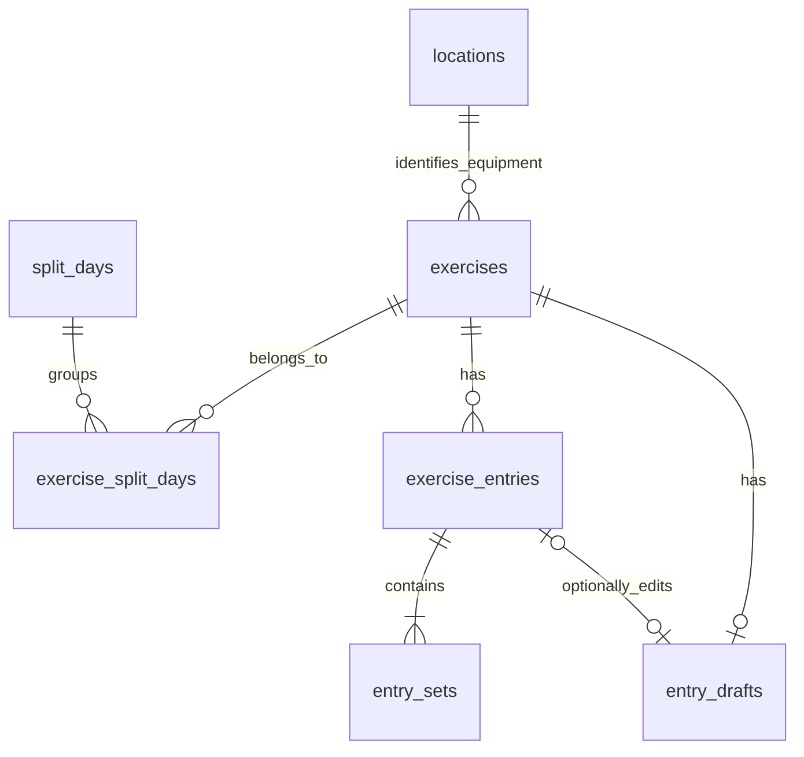

# Architecture and data rules

Liftlog is a single-package Flutter application. Screens use small controllers
and call `TrackerRepository`; all SQL stays in the repository/database layer.
`BackupService` handles the versioned JSON boundary. There are no accounts,
HTTP clients, cloud dependencies or background synchronization tasks.

## Storage

The authoritative v2 SQL is [schema.sql](../lib/core/database/schema.sql), loaded
as a Flutter asset by `AppDatabase`. On mobile, `sqflite` opens `liftlog.db` in
the app's private database directory. Foreign keys are enabled on every
connection. Tests inject an in-memory FFI database factory.

| Table | Identity and purpose | Important rules |
| --- | --- | --- |
| `locations` | Integer ID, display name, normalized name | Unique names; assigned locations cannot be deleted until exercises are reassigned. |
| `body_weights` | Integer ID, unique ISO date, integer grams, note, creation/update times | One positive measurement per calendar date, independent of exercise entries. |
| `exercises` | Integer ID, display name, normalized name, nullable location FK, archive flag | Trimmed/lowercased names are unique per location (including the Any location scope and archived exercises). History restricts physical deletion. |
| `split_days` | Integer ID, display name, normalized name | Unique normalized names. Deletion only cascades to association rows. |
| `exercise_split_days` | Composite exercise/split primary key | No duplicate memberships; reverse index supports filtering by split. |
| `exercise_entries` | Integer ID, exercise FK, performance time/offset, note, creation/update times | Independent performances; multiple entries per exercise/day are allowed. Exercise/time/ID index supports descending history. |
| `entry_sets` | Integer ID, entry FK, position, integer grams, integer reps_tenths | Positions start at 1 and are unique per entry. Nonnegative weight, positive reps stored as exact integer tenths. Entry deletion cascades to sets. |
| `entry_drafts` | Exercise FK/primary key, nullable editing-entry FK, JSON input, update time | At most one draft per exercise. Deleting the edited entry removes its editing draft. |

Saved entries must have at least one set, with consecutive ordered positions.
The repository enforces this in the transaction that saves the entry and its
sets. Editing replaces the sets atomically while retaining entry identity and
creation time. Draft ownership is checked in the repository. Empty exercises
may be deleted; populated exercises are archived.

## Values and dates

- Store kilograms as integer grams: 1.25 kg is 1250. Input accepts `.` or `,`
  as the decimal separator, at most three decimals, and no thousands separators.
- The simple load model uses 0 kg for bodyweight alone; positive values represent
  external/added load. Assistance is explained by exercise names or notes.
- Store timestamps as UTC Unix milliseconds and retain the recorded UTC offset
  for each performance. Display that recorded local time even after travel.
- Date/time changes select a time in the device's current timezone. Past offsets
  use that timezone's rule at the selected date. Existing offsets are retained
  unless the timestamp is changed.
- Calendar-day labels compare calendar dates, not elapsed 24-hour periods;
  same-day performances display zero days. Travel across the date line can
  produce reversed local dates; UI labels clamp those gaps to zero.
- History sorts by instant descending, then entry ID descending. Fetch one extra
  record to calculate the oldest visible card's gap across pagination boundaries.
- Renames and split changes apply to current exercise identity, without historical
  name or category snapshots. No session table is needed for independent entries.

## Draft consistency

`EntryController` snapshots each input change and serializes database writes.
Incomplete number strings are preserved. It waits for the queue before saving,
discarding, editing or deleting; saving also removes the draft in its transaction.
This prevents a queued write from resurrecting a saved/discarded draft.
Draft writes show saving/saved/error states. Failed writes retain the current
input and allow retry. Navigation waits for pending writes and warns on failure.
An abrupt process termination can still interrupt the latest uncommitted write.

## Backup interface

JSON format version 2 contains `formatVersion`, `appVersion`, `exportedAtUtc`
and an array named after each of the eight database tables. Rows use the exact
database column names/types, including nullable fields, IDs and draft JSON.

Export reads all tables in a single transaction. Import validates every table,
column, ID, reference, normalized name, set order, value range and draft ownership
before changing data. Draft fields may be incomplete; they must still be well
typed. An unsupported format is rejected rather than guessed.

Restore previews counts, offers an export of existing data, requires explicit
replacement confirmation, and replaces all tables in a single transaction.
An insertion failure rolls back deletions and inserts. Restore is never a merge.
No platform automatic backup is promised; Android's automatic app backup is
disabled. The exported JSON is unencrypted and includes notes/drafts.

## Version 2 migration and compatibility

`AppDatabase.version` is 2. The v1 upgrade rebuilds exercises to replace global name uniqueness with uniqueness per nullable location, preserving IDs and all referencing rows. Existing exercises get a null location (Any location). Set rows retain their IDs/order/weights while whole reps are multiplied by 10 into `reps_tenths`. Draft JSON retains the user’s original input strings.

Foreign keys are temporarily disabled before the upgrade transaction to rebuild the parent table, checked inside the transaction, then enabled on open. Migration errors roll back; no destructive fallback is used. The on-disk migration test uses the original SQL fixture and verifies notes, references, drafts and deletion protection.

Locations have unique normalized names. Deleting an assigned location is refused until its exercises, including archived ones, are reassigned. This avoids silently mixing gym equipment histories. The Any location filter shows all exercises; a specific gym matches its own exercises plus all null-location exercises. Search and split restrictions combine with this location condition.

`body_weights` stores a unique ISO calendar date, positive integer grams, optional note, and created/updated timestamps. Entries can be edited/deleted. Graph coordinates use actual date spacing; single-point and constant-weight series have a nonzero plotting range. Graph rendering uses Flutter’s CustomPainter without an external chart service or dependency.

Backup format 2 adds locations/body weights and uses reps_tenths. A v1 backup is upgraded in memory before validation, with empty new tables, null exercise locations and multiplied reps. Restore remains replacement, not merge.

For future schema changes, increment the database version, add a sequential transactional migration, update creation SQL, and test an old populated fixture. Update backup format compatibility when column types change.

## Mock access and navigation

The root auth gate shows Log in/Sign up before constructing any feature screens. It accepts any email/password, stores only the email in memory, never persists the password and resets on a cold start. Logout disposes the four-tab shell; local data is deliberately shared across mock sessions. This is a prototype UI gate, not real authentication or data isolation.

Workout, Weight, Manage and Profile are bottom destinations. Manage exposes exercise, location and split CRUD; Profile → Settings is the sole entry to Backup & restore. A fresh performance draft seeds blank rows matching the latest entry and shows corresponding previous-set values. Restored drafts preserve their row count; comparison excludes the entry currently being edited.

## Validation

Tests cover parsing, local-date calculations, foreign keys, memberships, search,
history ordering/pagination, archive/delete rules, entry rollback, draft queue
ordering/recovery, backup round-trips and rejection/rollback, and UI logging.
`integration_test/workout_test.dart` exercises native SQLite close/reopen,
editing and backup restore in a separate `integration-only.db`, not the user's
database. Widget layout tests write screenshots under `build/screenshots/`.

Future additions can include charts, PRs, CSV export, timers, pounds, explicit
load types, session grouping or cloud sync. None is part of the current storage
contract. A sync implementation would require deliberate conflict/identity work.
